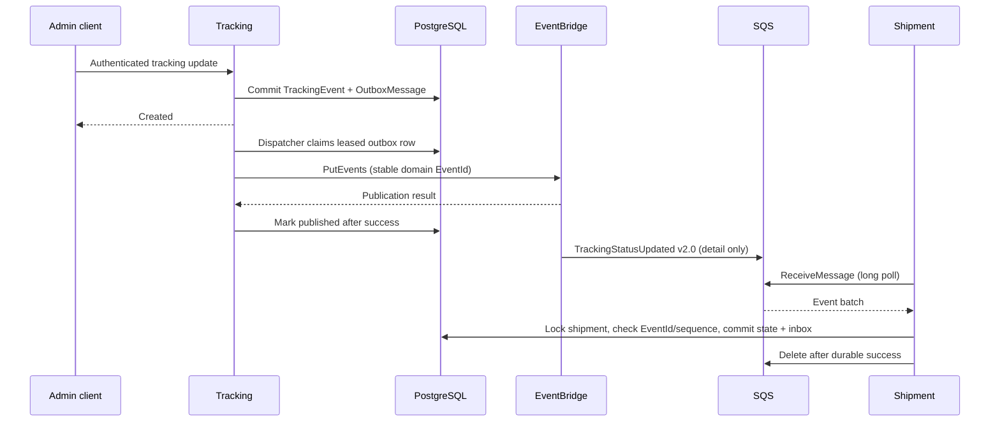
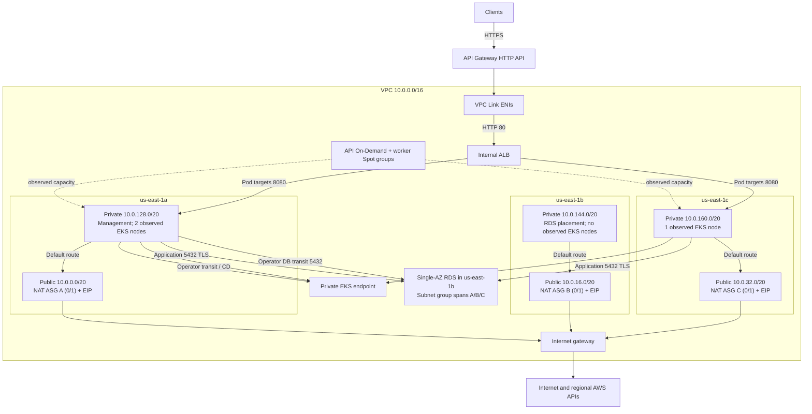

# Architecture

[Overview](../../README.md) · [IaC](infrastructure.md) · [Security](../security.md) · [Observed results](../results.md)

## Request and data flow

The only complete environment definition is `dev` in `us-east-1`; its runtime was retired on 29 October. The following describes the declared system and explicitly dated observations, not an active cluster. The HTTP API is public; its backends and Kubernetes control-plane endpoint are private. API Gateway uses a Lambda REQUEST authorizer for protected routes and connects through a VPC Link to an internal HTTP ALB. The Load Balancer Controller registers pod IP targets on port 8080.

| Service | Responsibility | Dependencies |
| --- | --- | --- |
| [Auth](../../microservices/auth-service) | Registration, login, refresh-token rotation, JWT issuance and user/admin endpoints | PostgreSQL `auth` schema |
| [Tracking](../../microservices/tracking-service) | Tracking timelines, admin event creation and transactional outbox dispatch | `tracking` schema, Shipment internal lookup, EventBridge |
| [Shipment](../../microservices/shipment-service) | Customer shipment API and SQS event consumption in one Deployment | `shipment` schema, SQS and event KMS key |

Auth uses ASP.NET Identity and HS256 JWTs. API Gateway replaces identity headers with authorizer context; Shipment/Tracking validate the proxy shared secret and enforce ownership/Admin policies. Source additionally requires Shipment/Tracking to send the original bearer to Auth's private `/auth/me` on each protected request and bind current identity/roles to the gateway attestation; see [ADR-005](../adr/005-current-profile-authorization.md). The [24 October matrix](../operations/eks-acceptance-2026-10-24.md) records scoped live enforcement of these checks, NetworkPolicy edges and TTL0; the [28–29 October cycle](../operations/eks-cycle-2026-10-29.md) separately records real authentication and resource authorization. Both are historical runtime evidence. Auth validates its JWTs itself. Internal Tracking→Shipment lookup uses a separate shared secret. These internal hops use HTTP, not mTLS.

Public routes are explicitly listed in [integration inputs](../../infra/live/dev/apigateway-integration/terragrunt.hcl) and checked by [the HTTP contract validator](../../scripts/validation/validate_r1.py). Registration/login/refresh are public. Shipment and tracking reads/writes require authentication; `/admin/tracking-events` requires Admin. Application controllers contain additional operations; their existence does not automatically expose them at the gateway. `/internal/*`, health and Swagger are not public gateway routes.

All three services share one RDS PostgreSQL instance with separate schemas and runtime/migration users. Readiness checks database connectivity; liveness checks process health. EF migrations run through Helm hook Jobs using migration identities. The application runtime does not bootstrap schemas or use the RDS master credential.

## Event path

The sequence shows a successful path; publication-marker persistence and downstream delivery are independent and can race.

Only `TrackingStatusUpdated` v2.0 is active. A publish-before-marker crash may duplicate an event; durable `ProcessedEvents` deduplication protects the business effect. Sequence N+2 arriving before N+1 is retried without advancing the checkpoint. The source queue is standard SQS, so ordering comes from application state, not transport guarantees. Processing failures and EventBridge delivery failures use separate DLQs. [Recovery](../operations/events.md) preserves event identity and repairs predecessors before replaying successors.

There is no active analytics worker or notification target. The [notification Lambda](../../lambdas/notification-lambda) is an inactive example, preserved as source rather than represented as deployed functionality.

## Network and Kubernetes placement

This topology annotates the **28–29 October deployment**. Compute, NAT and ingress were subsequently retired; the retained RDS network has no application ingress until reviewed reconstruction. Independent CloudFront/S3 hosting serves synthetic DEMO and is not a live path into EKS.

The diagram separates declared subnet eligibility from the final observed node placement **A/A/C**. Both managed groups allow all three private subnets; placement is not guaranteed. Earlier B/C observations in dated evidence describe a different run. Management used subnet A, and RDS was observed in B. A subnet group spanning three AZs does not make Single-AZ RDS Multi-AZ.

The declared NAT stack uses three single-AZ ASGs, each with one NAT EC2 when enabled and zero capacity while paused. A fenced launch callback verifies bootstrap and restores SourceDestCheck, the slot EIP and its private default route. Dev activation defaults to off. The installed cycle revision demonstrated one same-AZ replacement in 178 seconds. The later controller implementation has local validation; that earlier drill does not certify its current bytes. Continuous forwarding repair and cross-AZ failover are not configured. See [NAT recovery and migration](../operations/nat-recovery.md). This lowers lab cost while adding operational responsibility. The code defaults to `t3.micro`; historical operations included an OOM/resize incident. Review sizing before rebuilding; the default is not a demonstrated capacity guarantee.

The API group defaults to two On-Demand `t3.large` nodes (range 2–6), and the worker group to one Spot `t3.large` (range 1–10). Workload labels do not imply hard service placement: chart node selectors are empty and spread is soft. Root launch templates specify encrypted 50 GiB gp3 disks with IMDSv2. See [EKS source](../../infra/modules/eks).

## Controllers and ownership

| Owner | Resources |
| --- | --- |
| Terraform/Terragrunt | VPC/NAT, EKS/node groups/core addons, RDS, messaging, identity, secret containers, ECR/S3, API/VPC Link/security groups, management, CD and observability |
| `cluster-addons` Helm release | LBC, Cluster Autoscaler, Metrics Server, KEDA and ESO |
| `platform-bootstrap` release | Service accounts, RBAC, RDS CA, SecretStore, KEDA auth and NetworkPolicies |
| `platform-secret-sync` release | ExternalSecrets managed by ESO |
| `platform-services` release | Three Deployments/Services/migration Jobs/PDBs, Auth/Tracking HPA, Shipment ScaledObject and Ingress |
| AWS LBC | Internal ALB, listener, target groups, shared backend SG and target rules |

Terraform owns the frontend ALB SG, accepting HTTP only from the VPC Link SG. It discovers the LBC-created listener after workloads are healthy; it does not also own the load balancer. The separate releases keep the apps-scoped CD executor from installing platform identities/controllers. [Bootstrap ordering](../operations/deployment.md) handles this dependency.

JSON logs and EMF metrics feed CloudWatch alongside the managed observability addon, dashboard and alarms. CPU HPA controls Auth/Tracking (2–4); SQS KEDA controls Shipment (2–6); Cluster Autoscaler controls node capacity. PDBs and soft AZ/node spread reduce selected disruptions. Their presence is not proof of end-to-end HA. See [limits](../results.md#limitations).
